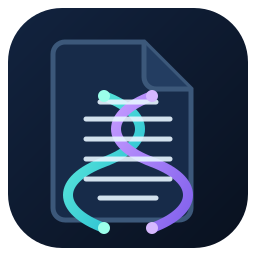
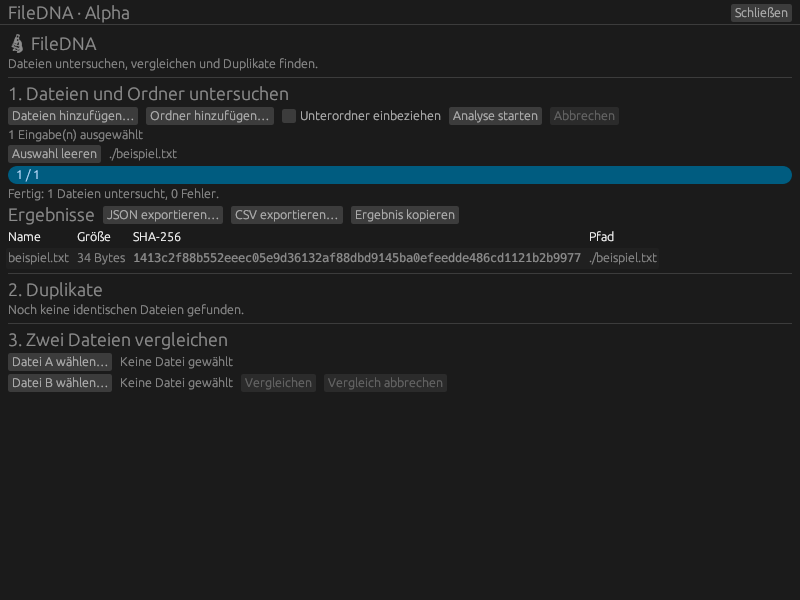

<div align="center">
  

  # FileDNA

  **Dateien untersuchen. Inhalte vergleichen. Duplikate finden.**

  Alpha-Version · Rust · egui
</div>

FileDNA ist ein Desktop-Programm zur Analyse von Dateien. Es zeigt Dateimetadaten an und berechnet SHA-256-Fingerabdrücke, um gleiche Inhalte wiederzuerkennen.

## Screenshot



## Funktionen

- Mehrere Dateien und Ordner gemeinsam untersuchen
- Unterordner optional rekursiv einbeziehen
- Name, Pfad, Dateigröße, Änderungsdatum und SHA-256 anzeigen
- Identische Dateien anhand ihres SHA-256-Hashes gruppieren
- Zwei ausgewählte Dateien vergleichen
- Ergebnisse als JSON oder CSV exportieren oder in die Zwischenablage kopieren
- Fortschritt anzeigen und Analysen oder Vergleiche abbrechen
- Dateien blockweise hashen, ohne den gesamten Dateiinhalt in den Arbeitsspeicher zu laden
- Fenster-Icon und Schließen-Button

## Starten

### Voraussetzungen

- Rust und Cargo (Edition 2024)
- Linux mit grafischer Desktop-Umgebung

Im Projektverzeichnis:

```bash
cargo run
```

Eine Datei oder einen Ordner kannst du direkt als Analyse-Eingabe übergeben. FileDNA startet die Analyse beim Öffnen:

```bash
cargo run -- ./beispiel.txt
```

Für einen Release-Build:

```bash
cargo build --release
```

## Bedienung

1. Mit **Dateien hinzufügen…** und **Ordner hinzufügen…** Eingaben auswählen.
2. **Unterordner einbeziehen** bei Bedarf aktivieren.
3. **Analyse starten** wählen. **Abbrechen** stoppt die laufende Analyse.
4. Die Ergebnisse erscheinen in der Tabelle; identische Hashes sind unter **Duplikate** gruppiert.
5. Für einen direkten Vergleich beide Dateien auswählen und **Vergleichen** anklicken.
6. Über die Export-Schaltflächen Ergebnisse speichern oder kopieren.
7. Mit **Schließen** das Programm beenden.

Symbolische Links werden bei Ordneranalysen nicht verfolgt. Nicht lesbare Dateien und Ordner werden als Fehler oder Hinweise aufgeführt.

## Projektstatus

Dies ist eine frühe Alpha-Version. Bedienoberfläche und Funktionen können sich noch ändern. Rückmeldungen und Fehlerberichte sind willkommen.

## Lizenz

Für dieses Projekt ist noch keine Lizenz festgelegt.
